# StockFlow — Inventory & Stock Management System

A full-stack inventory management application built with **React + TypeScript** on the front end and **FastAPI + SQLAlchemy + SQLite** on the back end. It gives a warehouse or office-store team a live view of stock levels, a full audit trail of every movement, reorder alerts, operational reports, and role-based access — without any external services or cloud dependencies.


---

## Table of contents

- [Overview](#overview)
- [Screenshots](#screenshots)
- [Features](#features)
- [Tech stack](#tech-stack)
- [Architecture](#architecture)
- [Data model](#data-model)
- [Project structure](#project-structure)
- [Getting started](#getting-started)
- [Configuration](#configuration)
- [Demo accounts and seed data](#demo-accounts-and-seed-data)
- [API reference](#api-reference)
- [Business rules](#business-rules)
- [Testing](#testing)
- [Production build](#production-build)
- [Project report](#project-report)
- [Troubleshooting](#troubleshooting)
- [Roadmap](#roadmap)

---

## Overview

Most small warehouses still track stock in spreadsheets, where every issue and receipt is a manual edit and the totals drift out of date. StockFlow replaces that with a single source of truth:

- **One catalogue** of products with category, supplier, pricing, storage location and min/max thresholds.
- **Two movement operations** — Stock In and Stock Out — each recorded as an immutable ledger entry with the previous and new balance, the acting user, a reference number and notes.
- **Live status** on every product: `IN_STOCK`, `LOW_STOCK` or `OUT_OF_STOCK`, derived from the current balance against the configured minimum.
- **Reports** for inventory valuation, stock movement history, low-stock/reorder lists and supplier coverage.
- **Role-based access** so administrators manage the catalogue and accounts while staff record movements.

The UI is deliberately **login-free for demonstration**: the front end boots straight into the dashboard, and the API falls back to the seeded demo administrator when no bearer token is supplied. JWT login remains fully functional for API clients and can be re-enabled in the UI without backend changes.

---

## Screenshots

| Dashboard | Product catalogue |
| --- | --- |
| 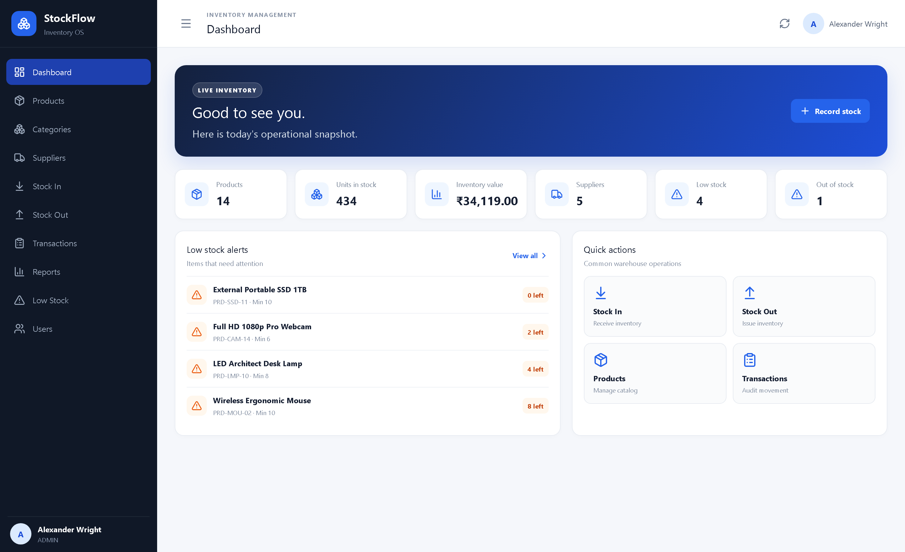 | 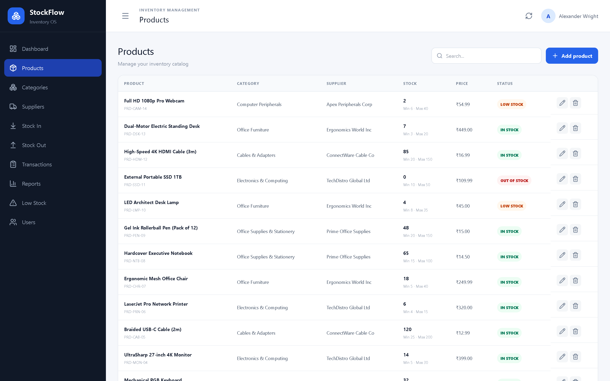 |

| Record stock receipt | Stock movement ledger |
| --- | --- |
| 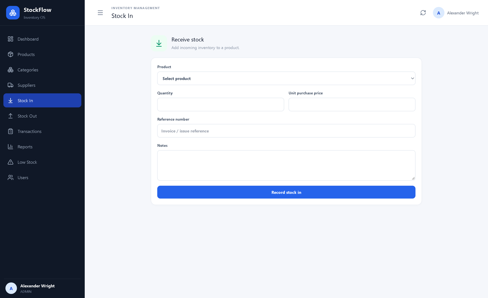 | 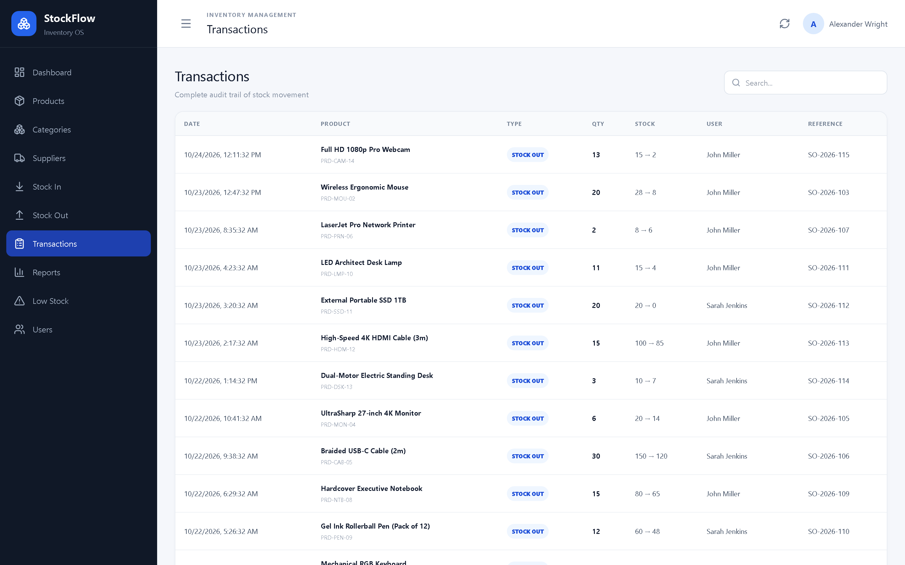 |

| Reports | Low-stock queue |
| --- | --- |
| 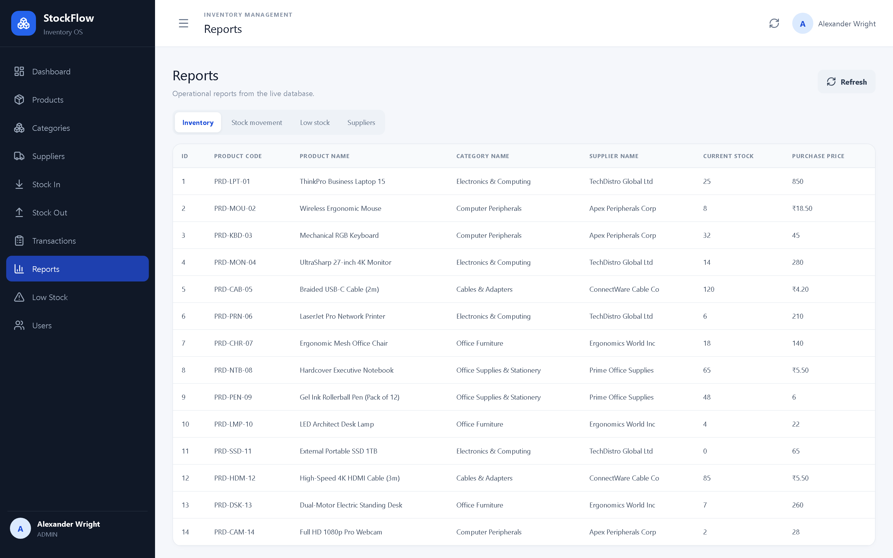 | 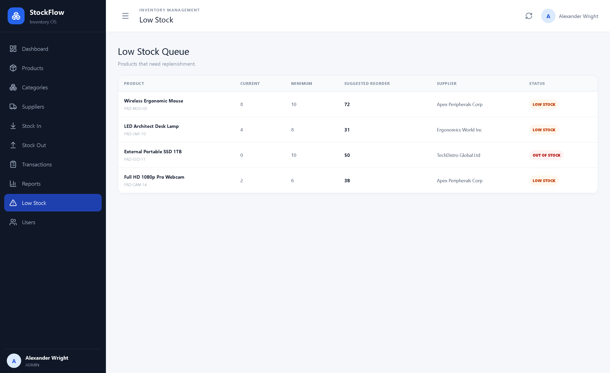 |

| Product form | User management |
| --- | --- |
| 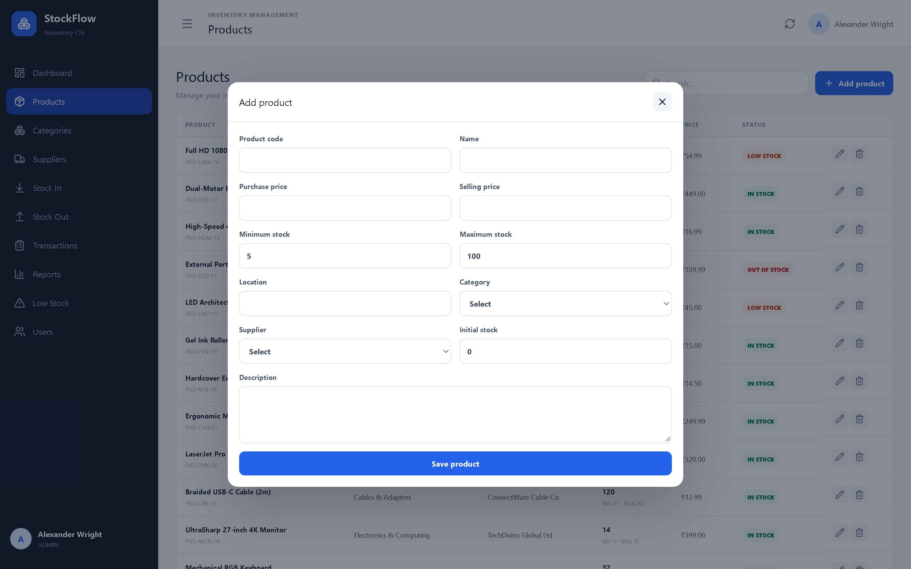 | 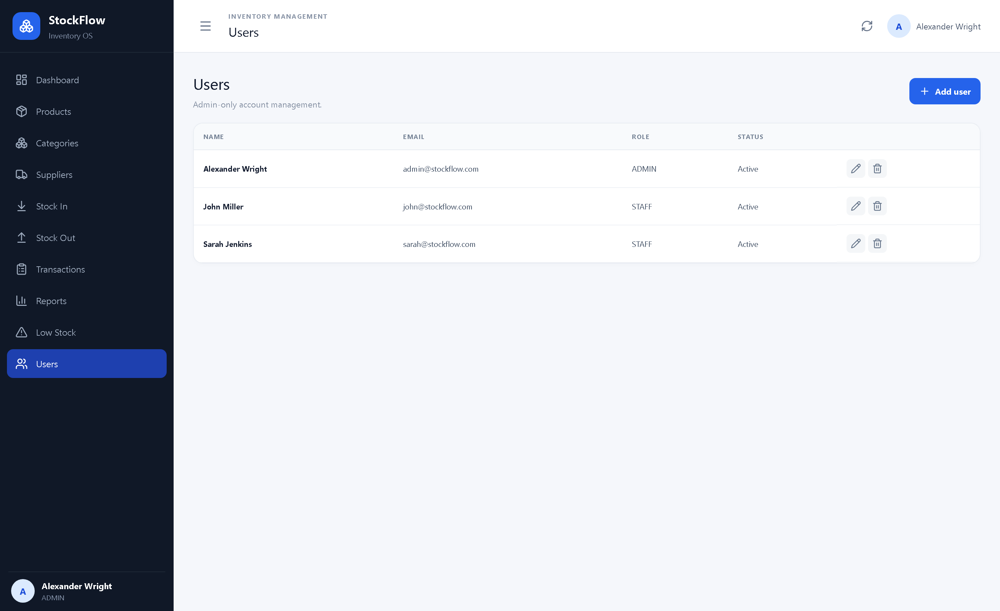 |

<p align="center">
  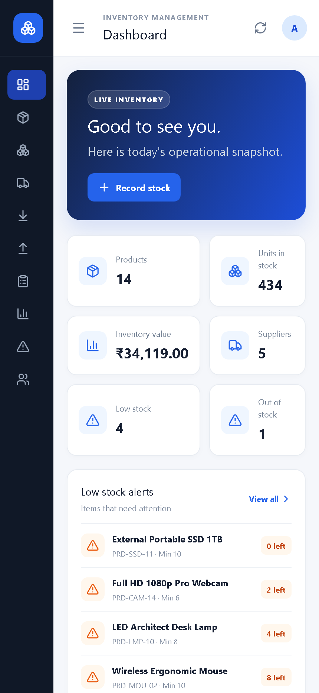
</p>

---

## Features

### Dashboard
- Six live KPI cards: total products, units in stock, inventory value (purchase cost), suppliers, low-stock count and out-of-stock count.
- Low-stock alert panel listing the products closest to (or past) their minimum threshold.
- Quick actions for Stock In, Stock Out, Products and Transactions.

### Product catalogue
- Searchable, paginated product list with category, supplier, stock, selling price and colour-coded status.
- Create, edit and delete products (administrators only) through a modal form.
- Validated fields: unique product code, non-negative prices, `maximum_stock` strictly greater than `minimum_stock`.
- Initial stock can be supplied when creating a product; it is booked as the opening balance.
- Delete is destructive and cascades to that product's movement history, so the UI asks for confirmation first.

### Stock operations
- **Stock In** increases the balance and optionally updates the product's purchase price when a new unit cost is supplied.
- **Stock Out** issues stock and is rejected if the requested quantity exceeds the balance on hand.
- Every operation writes a transaction row with `previous_stock`, `new_stock`, quantity, unit price, reference number, notes, timestamp and the acting user — giving a complete, replayable audit trail.

### Transactions
- Filter by free text (product name, product code, reference number or notes) and by movement type.
- Server-side pagination (default 15 per page, maximum 100) ordered newest first.
- Shows the user responsible for each movement.

### Reports
- **Inventory** — quantity and valuation per product, filterable by category, supplier and status.
- **Stock movement** — date-range and type-filtered history.
- **Low stock** — shortage quantity and the value needed to reach the minimum.
- **Suppliers** — product counts and inventory value per supplier.
- CSV export helpers are available in `frontend/src/utils/index.ts`.

### Accounts and access
- JWT bearer authentication (`/api/auth/login`) with bcrypt password hashing.
- `ADMIN` and `STAFF` roles; the Users screen is visible to administrators only.
- Account activation flag: deactivated users are rejected even with a valid token.

### Interface
- Responsive layout — collapsible sidebar on desktop, stacked cards and horizontally scrollable tables on mobile.
- Toast confirmations, inline error banners and loading indicators.
- INR currency and `en-IN` date formatting throughout.

---

## Tech stack

| Layer | Technology | Notes |
| --- | --- | --- |
| UI framework | React 19 + TypeScript 6 | Single-page app, function components and hooks |
| Build tool | Vite 8 | Dev server on port 5173, production bundling |
| Styling | Tailwind CSS 3 + custom CSS | Utility classes plus a hand-written design system in `App.css` |
| Icons | lucide-react | Consistent outline icon set |
| Charts | Recharts | Available for dashboard visualisations |
| HTTP client | Axios | Central instance with error-message normalisation |
| Routing | react-router-dom | Installed; current build uses an in-app page state |
| API framework | FastAPI | Auto-generated OpenAPI docs at `/docs` |
| ORM | SQLAlchemy 2.0 | Declarative models, relationships, session dependency |
| Validation | Pydantic 2 | Request/response schemas with field and model validators |
| Auth | PyJWT + bcrypt | HS256 access tokens, hashed passwords |
| Database | SQLite 3 | File-based, zero configuration |
| Server | Uvicorn | ASGI server with `--reload` for development |
| Tests | pytest + httpx | In-memory SQLite test database via `TestClient` |

---

## Architecture

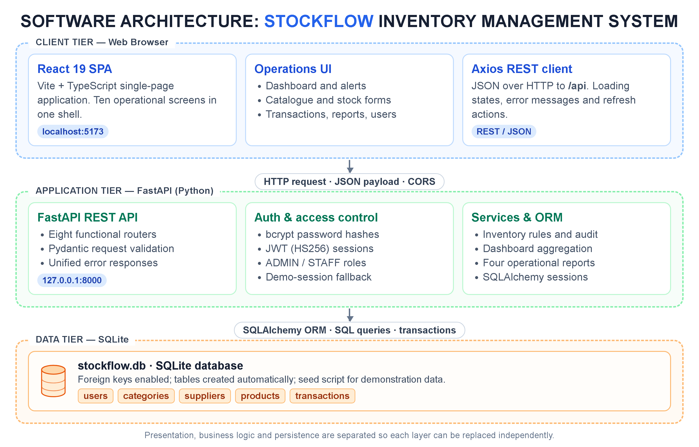

The system is a classic three-tier application:

```
Browser (React SPA)
        │  JSON over HTTP  →  http://127.0.0.1:8000/api
        ▼
FastAPI application
  ├── Routers      HTTP concerns, query parameters, status codes
  ├── Services     Stock movement and reporting business logic
  ├── Schemas      Pydantic validation and serialisation
  └── Models       SQLAlchemy ORM entities
        ▼
SQLite database (backend/stockflow.db)
```

**Request flow for a stock movement**

1. The React form posts to `/api/inventory/stock-in` or `/api/inventory/stock-out`.
2. `get_current_user` resolves the caller from the bearer token, or returns the demo administrator when no token is present.
3. The router delegates to `app/services/inventory_service.py`, which locks in the current balance, validates the quantity, computes the new balance, updates the product row and inserts the transaction row in one commit.
4. The response carries the full transaction, including the previous and new stock, so the UI can refresh the ledger immediately.

**Design decisions**

- Business rules live in services rather than routers, so stock arithmetic can be reused and unit-tested.
- The ledger stores balances as well as deltas; history stays meaningful even if a product's threshold changes later.
- Tables are created automatically on startup (`Base.metadata.create_all`), which keeps the demo portable.

---

## Data model

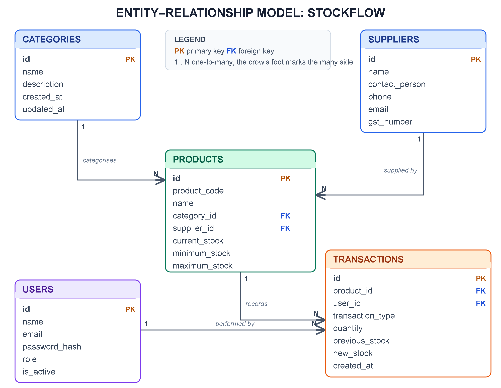

| Table | Key columns | Relationships |
| --- | --- | --- |
| `users` | `id`, `name`, `email` (unique), `password_hash`, `role` (`ADMIN`/`STAFF`), `is_active` | one-to-many → `transactions` |
| `categories` | `id`, `name` (unique), `description` | one-to-many → `products` |
| `suppliers` | `id`, `name`, `contact_person`, `phone`, `email`, `address`, `city`, `state`, `gst_number` | one-to-many → `products` |
| `products` | `id`, `product_code` (unique), `name`, `category_id`, `supplier_id`, `purchase_price`, `selling_price`, `current_stock`, `minimum_stock`, `maximum_stock`, `location` | many-to-one → `categories`, `suppliers`; one-to-many → `transactions` (`ON DELETE CASCADE`) |
| `transactions` | `id`, `product_id`, `user_id`, `transaction_type`, `quantity`, `previous_stock`, `new_stock`, `unit_price`, `reference_number`, `notes`, `created_at` | many-to-one → `products`, `users` (`ON DELETE SET NULL` on user) |

Derived values (`status`, `inventory_value`, `product_count`, shortage quantities) are computed in the API layer and never stored, so they cannot drift from the underlying rows.

---

## Project structure

```
inventory-stock-management/
├── backend/
│   ├── app/
│   │   ├── auth/                 # JWT creation/decoding, password hashing, dependencies
│   │   ├── models/               # SQLAlchemy entities (user, category, supplier, product, transaction)
│   │   ├── routers/              # auth, users, categories, suppliers, products, inventory, dashboard, reports
│   │   ├── schemas/              # Pydantic request/response models
│   │   ├── services/             # inventory, dashboard and report business logic
│   │   ├── config.py             # Settings loaded from environment / .env
│   │   ├── database.py           # Engine, session factory, Base, get_db dependency
│   │   └── main.py               # FastAPI app, CORS, error handlers, router registration
│   ├── tests/                    # pytest suite with an in-memory SQLite fixture
│   ├── seed.py                   # Rebuilds the demo dataset
│   ├── stockflow.db              # Pre-seeded SQLite database
│   ├── requirements.txt
│   └── .env.example
├── frontend/
│   ├── public/                   # favicon and icon sprite
│   ├── src/
│   │   ├── App.tsx               # Pages, navigation, modals and API calls
│   │   ├── App.css               # Design system and responsive layout
│   │   ├── index.css             # Tailwind entry point
│   │   ├── main.tsx              # React bootstrap
│   │   └── utils/index.ts        # Formatting, status helpers, CSV export
│   ├── index.html
│   ├── package.json
│   ├── tailwind.config.js
│   ├── vite.config.ts            # Port 5173 and /api proxy to :8000
│   └── .env.example
├── report_assets/                # Screenshots and diagrams used in this README and the report
├── reports/
│   ├── StockFlow_Project_Report.docx
│   ├── StockFlow_Project_Report.pdf
│   ├── build_report.py           # Regenerates the DOCX from the assets
│   └── assets/
├── start-backend.bat             # One-click backend launcher (Windows)
├── start-frontend.bat            # One-click frontend launcher (Windows)
└── README.md
```

---

## Getting started

### Prerequisites

| Requirement | Version |
| --- | --- |
| Python | 3.11 or newer |
| Node.js | 18 or newer (20+ recommended) |
| npm | Ships with Node.js |
| OS | Windows, macOS or Linux (the `.bat` launchers are Windows-only; the commands below are cross-platform) |

### 1. Clone

```bash
git clone https://github.com/vishwa-vup/stockflow-inventory-management.git
cd stockflow-inventory-management
```

### 2. Backend

```bash
cd backend

# Create and activate a virtual environment
python -m venv venv
# Windows
venv\Scripts\activate
# macOS / Linux
source venv/bin/activate

pip install -r requirements.txt

# Configuration
copy .env.example .env      # Windows
cp .env.example .env        # macOS / Linux

# Optional: rebuild the demo data (skip if backend/stockflow.db is present)
python seed.py

# Start the API
python -m uvicorn app.main:app --reload --port 8000
```

- API root: <http://127.0.0.1:8000>
- Swagger UI: <http://127.0.0.1:8000/docs>
- ReDoc: <http://127.0.0.1:8000/redoc>
- Health check: <http://127.0.0.1:8000/api/health>

### 3. Frontend

In a second terminal:

```bash
cd frontend
npm install
npm run dev
```

Open <http://localhost:5173>. The app loads the dashboard immediately — there is no login page.

### Windows one-click launchers

- `start-backend.bat` — opens the backend directory and runs Uvicorn on port 8000.
- `start-frontend.bat` — installs dependencies if needed and starts Vite on port 5173.

Keep both terminals open while using the app.

---

## Configuration

### Backend (`backend/.env`)

| Variable | Default | Purpose |
| --- | --- | --- |
| `PROJECT_NAME` | `StockFlow — Inventory & Stock Management System` | Displayed by the API root endpoint |
| `API_V1_STR` | `/api` | Prefix for every router |
| `SECRET_KEY` | Demo key | HMAC key for signing JWTs — replace for any real deployment |
| `ALGORITHM` | `HS256` | JWT signing algorithm |
| `ACCESS_TOKEN_EXPIRE_MINUTES` | `1440` | Token lifetime (24 hours) |
| `DATABASE_URL` | `sqlite:///./stockflow.db` | SQLAlchemy connection string, relative to `backend/` |

### Frontend (`frontend/.env`)

| Variable | Default | Purpose |
| --- | --- | --- |
| `VITE_API_URL` | `http://localhost:8000/api` | Documented backend base URL for the Vite proxy / future clients |

> The bundled UI currently targets `http://127.0.0.1:8000/api` directly from `frontend/src/App.tsx`. If you serve the API on a different host or port, update that constant (or point it at `import.meta.env.VITE_API_URL`).

---

## Demo accounts and seed data

`backend/stockflow.db` ships pre-seeded. Running `python seed.py` recreates the same dataset from scratch (it exits early if the demo admin already exists, so delete the database first for a clean rebuild).

| Role | Email | Password |
| --- | --- | --- |
| Administrator | `admin@stockflow.com` | `Admin@123` |
| Staff | `john@stockflow.com` | `Staff@123` |
| Staff | `sarah@stockflow.com` | `Staff@123` |

Seed contents:

- **5 categories** — Electronics & Computing, Computer Peripherals, Office Furniture, Office Supplies & Stationery, Cables & Adapters.
- **5 suppliers** — TechDistro Global, Apex Peripherals, Ergonomics World, Prime Office Supplies, ConnectWare Cable Co.
- **14 products** — laptops, monitors, keyboards, chairs, stationery and cables, spanning in-stock, low-stock and out-of-stock states.
- **29 transactions** spread across the previous week, with realistic reference numbers and notes.

Because the UI runs in demo mode, it acts as the seeded administrator and therefore shows every administrator-only control.

---

## API reference

Interactive documentation is available at `/docs`. All routes are prefixed with `/api`.

### Health and authentication

| Method | Endpoint | Access | Description |
| --- | --- | --- | --- |
| `GET` | `/` | Public | Service metadata and version |
| `GET` | `/api/health` | Public | Liveness probe, returns `{"status":"healthy"}` |
| `POST` | `/api/auth/login` | Public | Exchange email and password for a JWT |
| `GET` | `/api/auth/me` | Token or demo | Current user profile |

### Products

| Method | Endpoint | Access | Description |
| --- | --- | --- | --- |
| `GET` | `/api/products` | Any authenticated user (or demo) | Paginated list; filters: `search`, `category_id`, `supplier_id`, `stock_status`, `page`, `limit` |
| `GET` | `/api/products/{id}` | Any authenticated user | Single product with status and inventory value |
| `POST` | `/api/products` | Admin | Create a product, optionally with `initial_stock` |
| `PUT` | `/api/products/{id}` | Admin | Update product fields |
| `DELETE` | `/api/products/{id}` | Admin | Delete a product and its transaction history |

### Inventory operations

| Method | Endpoint | Access | Description |
| --- | --- | --- | --- |
| `POST` | `/api/inventory/stock-in` | Any authenticated user | Receive stock; optional unit purchase price updates the product cost |
| `POST` | `/api/inventory/stock-out` | Any authenticated user | Issue stock; rejected when quantity exceeds the balance |
| `GET` | `/api/inventory/transactions` | Any authenticated user | Paginated ledger; filters: `search`, `transaction_type`, `product_id`, `start_date`, `end_date`, `page`, `limit` |

### Categories and suppliers

| Method | Endpoint | Access | Description |
| --- | --- | --- | --- |
| `GET` | `/api/categories` | Any authenticated user | Categories with product counts |
| `POST` | `/api/categories` | Admin | Create a category (unique name) |
| `PUT` | `/api/categories/{id}` | Admin | Rename or re-describe a category |
| `DELETE` | `/api/categories/{id}` | Admin | Delete; blocked while products reference it |
| `GET` | `/api/suppliers` | Any authenticated user | Suppliers with product counts |
| `GET` | `/api/suppliers/{id}` | Any authenticated user | Single supplier |
| `POST` | `/api/suppliers` | Admin | Create a supplier |
| `PUT` | `/api/suppliers/{id}` | Admin | Update a supplier |
| `DELETE` | `/api/suppliers/{id}` | Admin | Delete; blocked while products reference it |

### Dashboard

| Method | Endpoint | Access | Description |
| --- | --- | --- | --- |
| `GET` | `/api/dashboard/stats` | Any authenticated user | Aggregate KPIs (products, units, value, suppliers, low/out of stock) |
| `GET` | `/api/dashboard/stock-overview` | Any authenticated user | Stock and valuation overview rows |
| `GET` | `/api/dashboard/stock-movement` | Any authenticated user | Recent stock-movement series |
| `GET` | `/api/dashboard/category-distribution` | Any authenticated user | Product count per category |
| `GET` | `/api/dashboard/low-stock-alerts` | Any authenticated user | Products at or below minimum stock |
| `GET` | `/api/dashboard/reorder-recommendations` | Any authenticated user | Suggested order quantities |

### Reports

| Method | Endpoint | Access | Description |
| --- | --- | --- | --- |
| `GET` | `/api/reports/inventory` | Any authenticated user | Valuation report; filters: `category_id`, `supplier_id`, `status` |
| `GET` | `/api/reports/stock-movement` | Any authenticated user | Movement history; filters: `start_date`, `end_date`, `transaction_type`, `product_id` |
| `GET` | `/api/reports/low-stock` | Any authenticated user | Shortage list with reorder value |
| `GET` | `/api/reports/suppliers` | Any authenticated user | Supplier coverage and value |

### Users

| Method | Endpoint | Access | Description |
| --- | --- | --- | --- |
| `GET` | `/api/users` | Admin | List accounts |
| `POST` | `/api/users` | Admin | Create an account |
| `PUT` | `/api/users/{id}` | Admin | Update name, email, role, active flag or password |
| `DELETE` | `/api/users/{id}` | Admin | Delete an account (you cannot delete your own) |

### Example requests

Log in and call an authenticated endpoint:

```bash
curl -X POST http://127.0.0.1:8000/api/auth/login \
  -H "Content-Type: application/json" \
  -d '{"email":"admin@stockflow.com","password":"Admin@123"}'

# → {"access_token":"<jwt>","token_type":"bearer","user":{...}}

curl http://127.0.0.1:8000/api/products?page=1\&limit=10 \
  -H "Authorization: Bearer <jwt>"
```

Record a receipt and an issue:

```bash
curl -X POST http://127.0.0.1:8000/api/inventory/stock-in \
  -H "Content-Type: application/json" \
  -d '{"product_id":1,"quantity":10,"unit_purchase_price":850,"reference_number":"INV-2026-020","notes":"Quarterly replenishment"}'

curl -X POST http://127.0.0.1:8000/api/inventory/stock-out \
  -H "Content-Type: application/json" \
  -d '{"product_id":1,"quantity":3,"reference_number":"SO-2026-120","notes":"Issued to design team"}'
```

### Error responses

Every error returns a JSON body with a human-readable `detail`:

```json
{ "detail": "Insufficient stock. Available quantity: 2." }
```

| Status | Meaning |
| --- | --- |
| `400` | Business-rule violation (insufficient stock, duplicate code, category in use) |
| `401` | Missing, expired or invalid token |
| `403` | Authenticated but the role is not permitted |
| `404` | Entity not found |
| `422` | Request validation failed (field-level messages are joined into `detail`) |
| `500` | Unhandled server error (logged server-side, generic message returned) |

---

## Business rules

**Stock status** (computed per request, never stored):

```
current_stock == 0                  → OUT_OF_STOCK
current_stock <= minimum_stock      → LOW_STOCK
otherwise                           → IN_STOCK
```

**Stock In**
- Quantity must be greater than zero.
- `new_stock = previous_stock + quantity`.
- If `unit_purchase_price` is supplied and non-negative, the product's `purchase_price` is updated to it.
- A transaction row is written in the same commit as the balance change.

**Stock Out**
- Quantity must be greater than zero.
- Rejected with `400` when `quantity > current_stock`; balances can never go negative.
- `new_stock = previous_stock - quantity`, valued at the product's selling price.
- An optional `customer_department` is prefixed to the stored notes.

**Products**
- `product_code` is unique (case-sensitive string) and at least two characters.
- `maximum_stock` must be strictly greater than `minimum_stock`.
- Prices and `minimum_stock` cannot be negative.
- `initial_stock` is only applied on creation.

**Deletion**
- Products cascade-delete their transactions.
- Categories and suppliers with linked products are protected and return `400`.
- User deletion sets the `user_id` of their historical transactions to `null` (recorded as “System”).

**Authorisation**
- Catalogue writes (products, categories, suppliers) and all user management require the `ADMIN` role.
- Read endpoints and stock movements are available to any active user.
- Deactivated accounts are rejected on every request.

---

## Testing

```bash
cd backend
python -m pytest -q
```

The suite runs against an in-memory SQLite database with its own fixtures, so it never touches `stockflow.db`. It covers:

| Test | What it verifies |
| --- | --- |
| `test_login_success` | Valid credentials return a token and user payload |
| `test_login_invalid_password` | Wrong password returns `401` with a clear message |
| `test_rbac_admin_only_users_endpoint` | Staff receives `403` on `/api/users`, admin receives `200` |
| `test_product_crud_and_validation` | Invalid min/max rejected, creation succeeds, staff cannot delete, admin can update |
| `test_stock_in_and_stock_out_flow` | Balances and ledger rows stay consistent across both operations |
| `test_insufficient_stock_rejection` | Stock-out beyond the balance is rejected and nothing changes |
| `test_low_stock_and_reorder_calculation` | Status thresholds and reorder quantities are correct |
| `test_dashboard_stats` | Aggregates match the underlying rows |

Expected result: **8 passed**.

---

## Production build

```bash
cd frontend
npm run build      # type-checks with tsc then bundles into frontend/dist/
npm run preview    # serves the built bundle locally
npm run lint       # oxlint
```

Serve `frontend/dist/` from any static host and run the API with a production ASGI server, for example:

```bash
cd backend
python -m uvicorn app.main:app --host 0.0.0.0 --port 8000 --workers 4
```

Before deploying:

1. Replace `SECRET_KEY` with a strong random value.
2. Narrow the CORS `origins` list in `backend/app/main.py` to your real front end.
3. Point the front end at the deployed API URL.
4. Remove or protect the demo-administrator fallback in `backend/app/auth/dependencies.py` if the deployment must enforce login.
5. Back up `stockflow.db` (or migrate to PostgreSQL by changing `DATABASE_URL` and installing a driver).

---

## Project report

A complete academic project report describing the system is included in [`reports/`](reports/):

- [`StockFlow_Project_Report.docx`](reports/StockFlow_Project_Report.docx) — editable Word document (38 pages)
- [`StockFlow_Project_Report.pdf`](reports/StockFlow_Project_Report.pdf) — print-ready PDF

The report covers the problem statement, domain review, system design, implementation, testing and evaluation, conclusion and future work, plus architecture and ER diagrams and annotated screenshots.

Regenerate the Word document after changing content or figures:

```bash
cd reports
python build_report.py     # writes StockFlow_Project_Report.docx
```

The generator reads images from `reports/assets/` (copied from `report_assets/`) and requires `python-docx`. Export the DOCX to PDF with Word or LibreOffice, or open it directly to edit.

---

## Troubleshooting

| Symptom | Cause and fix |
| --- | --- |
| “Cannot reach the StockFlow API” banner | Backend is not running or is on another port. Start it on `127.0.0.1:8000` and press Retry. |
| `ModuleNotFoundError` on startup | Dependencies not installed in the active environment. Run `pip install -r requirements.txt`. |
| `address already in use` | Another process owns port 8000 or 5173. Stop it, or run Uvicorn with `--port 8001` and update the API base URL in `frontend/src/App.tsx`. |
| Empty dashboard after a fresh clone | `backend/stockflow.db` was removed. Run `python seed.py` from `backend/`. |
| `seed.py` says it is skipping | The demo admin already exists. Delete `backend/stockflow.db` and re-run to rebuild. |
| Dates or currency look unexpected | Formatting uses `en-IN` / INR by design; adjust the helpers in `frontend/src/utils/index.ts`. |
| Login works but the UI still shows admin | The UI intentionally runs without a token and falls back to the demo administrator. Send the bearer token yourself to exercise role restrictions. |
| Windows SmartScreen blocks a `.bat` file | Run `python -m uvicorn app.main:app --reload --port 8000` manually instead. |

> Do not use a committed `backend/venv` from another machine — create a fresh virtual environment locally. The repository intentionally excludes it.

---

## Roadmap

- Enforce login in the UI with a proper session/refresh flow, keeping demo mode behind a flag.
- PostgreSQL support for multi-user deployments, with Alembic migrations.
- Barcode/QR scanning for receipts and issues.
- Email or webhook alerts when a product crosses its minimum threshold.
- Purchase orders and goods-received notes linked to suppliers.
- CSV/Excel export buttons on every report screen.
- Dashboard charts for category distribution and movement trends.
- Audit log for catalogue edits, not just stock movements.

---

## Author

Built as an academic full-stack project by [vishwa-vup](https://github.com/vishwa-vup).

If you find it useful, a star is appreciated. Questions and suggestions are welcome through GitHub issues.

---

## License

This project is provided for educational use. You are free to study, fork and adapt it; please credit the original author.

